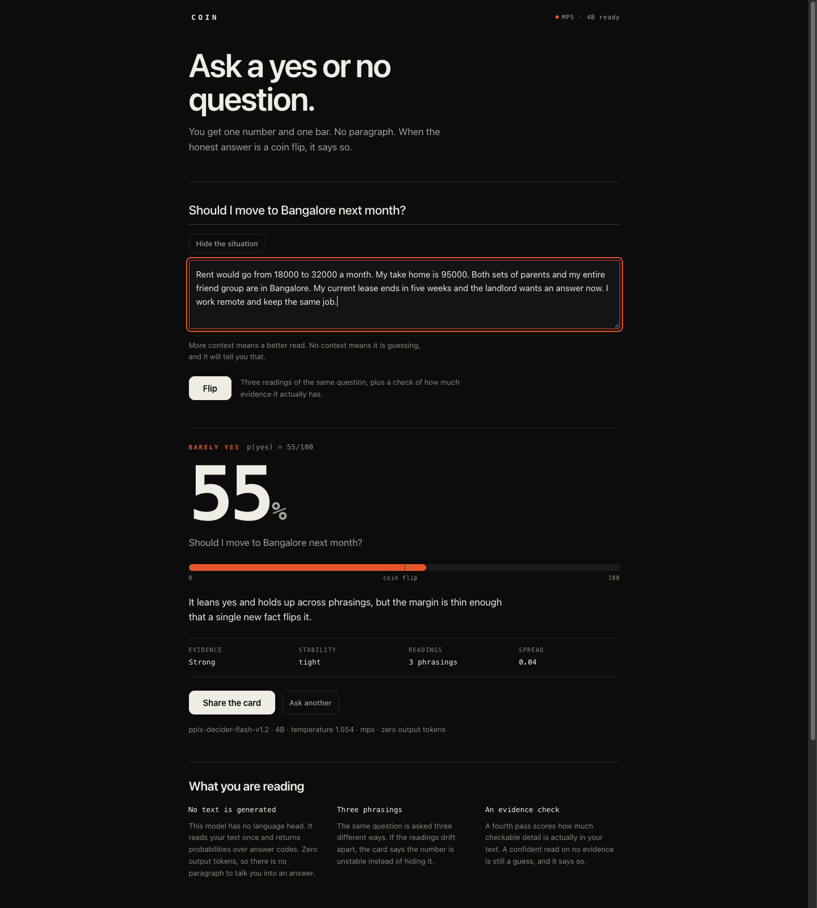
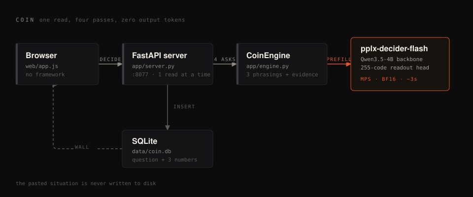
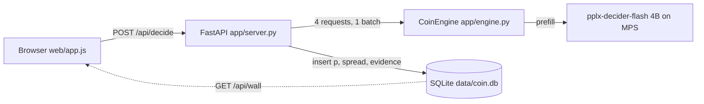

# Coin

**A public yes/no oracle with one rule: it tells you when the answer is a coin flip.**

Ask a question, optionally paste the situation. You get one calibrated probability and one bar, plus three signals that keep it honest: how much evidence was in your text, how stable the number is across phrasings, and a verdict word that says `guessing` when there was nothing to read.

No paragraph. No "it depends". No 400 tokens of hedging. The model has no language head at all.



---

## Table of contents

- [Why this exists](#why-this-exists)
- [The four states](#the-four-states)
- [Architecture](#architecture)
- [Tech stack](#tech-stack)
- [Quickstart](#quickstart)
- [How a read is computed](#how-a-read-is-computed)
- [API](#api)
- [Measured performance](#measured-performance)
- [Known limits, stated plainly](#known-limits-stated-plainly)
- [Project layout](#project-layout)
- [Fork it](#fork-it)
- [Contributing](#contributing)
- [Feature ideas worth building](#feature-ideas-worth-building)
- [Credits](#credits)
- [License](#license)

---

## Why this exists

A chat model asked "should I take this job?" will write you three paragraphs that quietly assume its own answer. The prose is the problem: it creates confidence the probability never had.

`pplx-decider-flash-v1.2` is the opposite shape. Perplexity distilled a 27B decision model into a Qwen3.5-4B backbone, replaced the language head with a 255-code readout, and the model now returns calibrated probabilities over typed questions (`choice`, `noul` for yes/no, `score` for ordinals). It generates **zero output tokens**. A read costs one prefill pass.

That makes it a great oracle and a terrible fortune teller, and the honest product is the one that shows the difference. Coin is that product:

- it **refuses** to present a prior as a prediction,
- it shows **how much evidence** it had,
- it shows **how much the phrasing moves the number**,
- and it saves only the question, never the situation you pasted.

## The four states

The card is a state machine, not a number. Only the last state is a forecast.

| State | Trigger | What the card does |
|---|---|---|
| `guessing` | evidence < 0.15 | bar turns grey, "a prior, not a prediction" |
| `unstable` | spread across phrasings >= 0.18 | names the spread in points, says phrasing is doing the work |
| `coin flip` | \|p - 0.5\| <= 0.06 | the number turns vermillion and the card says it will not pretend |
| `yes` / `leans yes` / `barely yes` | evidence present, spread tight | the actual read, graded by margin |


That first row is not a technicality. Measured across ten evidence-free questions, the model returned a confident-looking 0.67 to 0.93 with an evidence score near 0.02. Left alone, that reads as an answer. Stated plainly, it is the most useful thing on the page.

## Architecture



One process, one model, one small database.



The engine wraps the vendor's `Decider` and never edits it. A read is four protocol-v3 requests in one `decide()` call, then arithmetic in Python.

## Tech stack

| Layer | Choice | Why |
|---|---|---|
| Model | `perplexity-ai/pplx-decider-flash-v1.2` (Qwen3.5-4B, BF16) | 9.1 GB, runs on a consumer Mac, 0 output tokens |
| Runtime | Python 3.12, `torch` 2.14 with MPS | Apple GPU, unified memory, no CUDA needed |
| Serving | FastAPI + Uvicorn | one file, one endpoint, one lock |
| Storage | SQLite | the wall is a table, not a service |
| Front end | vanilla HTML/CSS/JS | no build step, no framework, no dependencies |
| Share card | Canvas 2D, drawn client-side | the screenshot people post is generated in the browser |

Nothing here needs a node toolchain, a bundler, or a container. The whole app is five files.

## Quickstart

```bash
git clone <this repo> coin && cd coin

# 1. the checkpoint (9.1 GB, two shards)
python3 -c "from huggingface_hub import snapshot_download; snapshot_download('perplexity-ai/pplx-decider-flash-v1.2', local_dir='ckpt')"

# 2. python 3.12 venv, no system packages needed
uv venv --python 3.12 .venv
uv pip install --python .venv/bin/python -r requirements.txt

# 3. smoke test: loads the model, runs four reads, prints latency
.venv/bin/python probe.py ./ckpt mps bfloat16

# 4. serve
./run.sh            # http://0.0.0.0:8077
```

Env knobs:

```bash
PORT=9000 ./run.sh
COIN_DEVICE=mps ./run.sh        # or cpu
COIN_DTYPE=bfloat16 ./run.sh    # or float32
COIN_DB=/tmp/coin.db ./run.sh
```

## How a read is computed

Three phrasings of the same proposition, plus one evidence check. The model card says one question per request is the safer default for this checkpoint, so each question is its own request, batched into one call:

```python
PHRASINGS = (
    'The answer to the question "{q}" is yes.',
    'If someone asks "{q}", the correct answer is yes.',
    'Taking the situation into account, "{q}" should be answered yes.',
)

EVIDENCE_LEVELS = (
    "no evidence, only the question itself",
    "a vague hint, nothing checkable",
    "some relevant specifics",
    "concrete numbers, constraints and details",
)
```

`p` is the mean of the three readings, `spread` is max minus min, and `evidence` is the ordinal score normalised to 0..1:

```python
readings = [float(r["answers"][k]["noul"]) for r, k in zip(responses[:3], keys)]
ev = responses[3]["answers"]["evidence"]
evidence = float(ev["score"]) / (len(EVIDENCE_LEVELS) - 1)

return Read(
    p=sum(readings) / len(readings),
    spread=max(readings) - min(readings),
    evidence=max(0.0, min(1.0, evidence)),
)
```

The temperature is the checkpoint's own, fitted on held-out data (1.5539). `decide()` applies it once and softmaxes over valid codes only. We do not touch it.

### The dtype seam

The vendor loader chooses `bfloat16` on CUDA and `float32` everywhere else. On Apple silicon that doubles the footprint to ~18 GB for no accuracy gain. Coin wraps `from_pretrained` instead of patching their source:

```python
def patch_qwen3_5_dtype(torch, target):
    from transformers.models.qwen3_5 import modeling_qwen3_5 as m
    original = m.Qwen3_5Model.from_pretrained.__func__

    def wrapper(cls, *args, **kwargs):
        kwargs["dtype"] = target
        return original(cls, *args, **kwargs)

    m.Qwen3_5Model.from_pretrained = classmethod(wrapper)
    return lambda: setattr(m.Qwen3_5Model, "from_pretrained", classmethod(original))
```

## API

`POST /api/decide`

```json
{
  "question": "Should I move to Bangalore next month?",
  "context": "Rent goes from 18000 to 32000. Take home is 95000. Lease ends in five weeks."
}
```

```json
{
  "question": "Should I move to Bangalore next month?",
  "p": 0.5502,
  "spread": 0.0401,
  "evidence": 0.93,
  "readings": 3,
  "model": "pplx-decider-flash-v1.2",
  "params": "4B",
  "temperature": 1.5539092221462472,
  "device": "mps",
  "usage": { "input_tokens": 691, "output_tokens": 0, "sequences": 4 },
  "seconds": 2.78
}
```

- `GET /api/wall?sort=closest|recent&limit=12` returns `[{question, p}]`
- `GET /api/health` returns `{model_loaded, device, dtype, error, load_seconds}`

Reads are serialised by a process-wide lock, so one Mac Mini serves one question at a time. That is a deliberate limit, not a bug.

## Measured performance

On an M4 Mac Mini (64 GB, macOS 27.0.1), BF16 on MPS:

| Metric | Value |
|---|---|
| Model load to GPU | 5.2 s warm, 8.5 s cold |
| One full read (4 passes, ~750 input tokens) | 2.7 to 3.7 s |
| Output tokens | 0 |
| Checkpoint on disk | 8.5 GiB (two shards, 9.1 GB) |
| Peak unified memory | ~10 GB |

The backbone is a hybrid linear-attention model, and `causal_conv1d` / `flash-linear-attention` are not installed on macOS, so it runs the reference kernels. That is the honest reason a read is ~3 s and not ~300 ms.

## Known limits, stated plainly

- **No context means no read.** Ten evidence-free questions produced 0.67 to 0.93 with evidence near 0.02. The model leans yes on almost everything with nothing to read. Hence the `guessing` state.
- **Knowledge is its weakest axis** (42.0 on the Decision Index vs 76.7 on tools). Coin judges text you supply. Do not ask it about the world.
- **Calibration is inherited, not proven here.** The checkpoint reports ECE 0.021 on its own development set. We have not re-measured calibration on Coin's question distribution.
- **English phrasing.** The three-phrasing stability check is English-only, which also means non-English questions get an artificially wide spread.
- **No auth, no rate limit.** It is a demo on a LAN. Put it behind a tunnel and a limiter before it meets the public internet.
- **The wall is public and permanent** for questions asked. The situation is not stored, but the question is.

## Project layout

```
coin/
├── app/
│   ├── engine.py         the model wrapper, phrasings, evidence pass, dtype seam
│   └── server.py         FastAPI, /api/decide, /api/wall, SQLite, the lock
├── web/
│   ├── index.html        one page, four states
│   ├── styles.css        token system, no framework
│   └── app.js            fetch, render, wall, canvas share card
├── assets/               architecture diagram, screenshots
├── probe.py              smoke test, prints p/spread/evidence/latency
├── seed.py               fills the wall with real reads
├── run.sh                one-command bring-up
├── requirements.txt
└── ckpt/                 the checkpoint (gitignored, 8.5 GiB)
```

## Fork it

```bash
git clone <your fork> && cd coin
uv venv --python 3.12 .venv
uv pip install --python .venv/bin/python -r requirements.txt
python3 -c "from huggingface_hub import snapshot_download; snapshot_download('perplexity-ai/pplx-decider-flash-v1.2', local_dir='ckpt')"
.venv/bin/python probe.py ./ckpt mps bfloat16
```

You do not need to touch the model to change the product. Every honesty decision lives in one function:

```js
// web/app.js
function verdict(p, spread, evidence) {
  const d = Math.abs(p - 0.5);
  if (evidence < 0.15) return { label: 'guessing', kind: 'guess' };
  if (spread >= 0.18) return { label: 'unstable', kind: 'unstable' };
  if (d <= 0.06) return { label: 'coin flip', kind: 'flip' };
  // ...
}
```

Change the thresholds, change the product's personality. Same for the question set in `app/engine.py` (`PHRASINGS`, `EVIDENCE_LEVELS`), which is where most of the behaviour actually comes from.

Testing without a GPU: set `COIN_DEVICE=cpu` (slow but correct), or stub the engine in a test harness and assert the state machine in `verdict()` across a grid of `p`/`spread`/`evidence` values. The thresholds are the part worth unit-testing.

## Contributing

Four rules that keep the thing honest:

1. **No number without its evidence.** Any new metric shown to a user needs a companion that says how much it can be trusted.
2. **Never let a state pretend.** If a change makes `guessing` look like `yes`, it will not be merged.
3. **No mocks in the shipped path.** Dev stubs are fine in tests, never in `app/engine.py`.
4. **Disclose the seam.** If you patch vendor code or swap the model, say exactly what changed in the PR description and in this README.

A PR is good when it includes: what changed, the read latency before and after, and one real request/response pair showing the new behaviour.

## Feature ideas worth building

Each of these is a real extension, not a wish.

1. **A calibration harness.** Take 200 questions with known outcomes (or a public decision dataset), plot predicted p against observed frequency, publish the reliability curve. This is the single most valuable missing piece, and it is entirely measurable.
2. **Vision reads.** The checkpoint takes images up to 1.6 MP. "Should I buy this listing?" with a screenshot is already possible: add `images` to the request and a drop zone to the form. Zero new model work.
3. **Second opinion mode.** Two personas in the instructions ("a sceptical CFO", "the person who has to live with it"), compared side by side. Cheap: same model, different instructions.
4. **Decision journal.** Store the outcome next to the read, then show how often the model beat you per topic. Turns a toy into a training tool.
5. **Phrasing languages.** Add Hindi, Telugu and Spanish phrasings of the same proposition and let the spread become a genuine multilingual consistency check.
6. **Wall as an API.** `GET /api/wall?q=...` with a stable schema, so other people can build leaderboards on what the internet asks when it cannot decide.
7. **Streaming the passes.** Render each of the three readings as it lands instead of waiting ~3 s. Perceived latency drops even though total work does not.
8. **Batch mode for a whole list.** The card notes this checkpoint prefers one question per request, but it still batches. Feeding 50 questions in one call gives a fast CSV annotator for any list of yes/no judgements.

## Credits

- Model and reference implementation: [perplexity-ai/pplx-decider-flash-v1.2](https://huggingface.co/perplexity-ai/pplx-decider-flash-v1.2), Apache-2.0, built on Qwen3.5-4B. The `pplx_decider` source is vendored unmodified inside `ckpt/`.
- Everything else, including the honesty states and the interface: this repo.

## License

Apache-2.0. [LICENSE](LICENSE) holds the full text. [NOTICE](NOTICE) carries the attribution the license requires: the decision model and the `pplx_decider` reference implementation are Perplexity AI's work, running on the Qwen3.5-4B architecture from Alibaba Group, both Apache-2.0. Neither the checkpoint nor the vendored source is distributed in this repository; both are downloaded at setup and excluded from version control.

Copyright 2026 Harish Kotra.